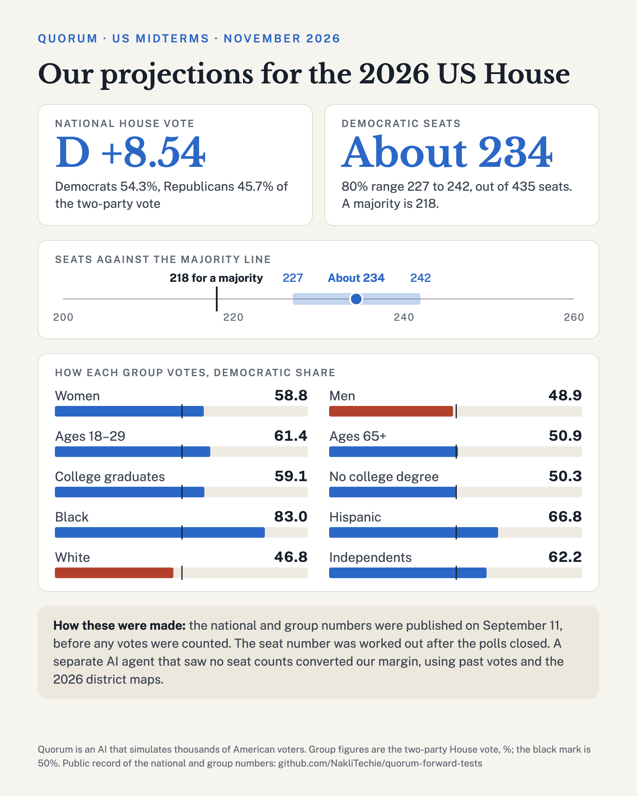
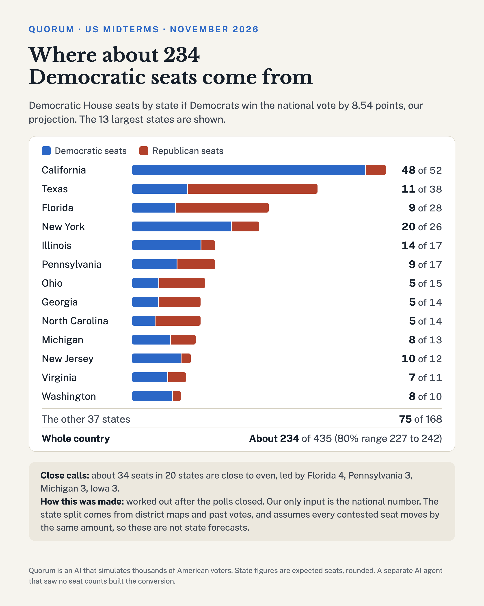

# Our 2026 midterm projections

Quorum is an experiment in predicting public opinion and elections with a language model and simulated voters. We give a
fine-tuned open model (Qwen3-14B) about 3,170 voter profiles built from real survey demographics. We ask each profile how it
would vote, then weight and add up the answers. This page lists what we said, when we said it, and how to check it.

*Last updated 2026-11-05, 09:00 IST. Early comparisons below will change as votes are counted.*

## Read this first: the date in the prompt moved our number

We found this on Nov 5, after the election. The words "September 11" in the prompt lift our national number by about 2.6 points. The same setup with any other date we tried says about D +6, and that is what the engine said in every other run this season. The registered D +8.54 stands and is scored in December. If it lands close, part of that closeness comes from the date, not from skill. At D +6 the seat table gives about 225, not 234. [The evidence is here](capstone/date-sensitivity/README.md).

## What we projected

| Projection | Number | Fixed when | Scored against |
|---|---|---|---|
| National House vote, two-party | **Democrats +8.54** (54.27 to 45.73) | Sep 11, before the election | Certified count, mid-December. Must land within 3 points and beat the polling average (RealClearPolitics, Democrats +8.9). |
| Vote in 17 voter groups | Women 58.8, men 48.9, ages 18-29 61.4, ages 65+ 50.9, White 46.8, Black 83.0, Hispanic 66.8, college graduates 59.1, no degree 50.3, and more | Numbers Sep 11; scoring rule Nov 3, before the polls closed | AP Voter Poll, Nov 5. Group error 6 points or less, lean error 4 or less, and compare with the 2022 pattern. |
| Democratic House seats | **About 234** (80% range 227 to 242) | **After the polls closed**, Nov 4 | Final seat count. This is a conversion of the national number, not an advance forecast. |

We made no Senate or governor projections, and no state-level vote projections.

## How the seat number was made

A separate AI agent built a district-level table for all 435 seats. Each seat starts from its own Cook 2026 PVI, adjusted for
the incumbent. One national shift then moves every contested seat, set so that the seats add up to the national margin.
40,000 simulated elections add national, state and district error. We read the table at D +8.54. The state card is the same
simulations grouped by state. Quorum's only input is the national number, so these are not state forecasts by Quorum.

The agent saw no 2026 seat count or vote total, but its start-up context did show D +8.54 and one early voter-poll comparison.
That was our error, and [its log](capstone/seats/exposure.md) records it.

## What we know so far

This is an informal early read, not a score. The official group score uses a capture on Nov 5.

- **House control:** NBC and CBS projected Democrats to win. NBC's seat estimate moved from 248 to 187 at 22:35 ET to 255 to 180 at 00:46 ET, with 219 to 120 called.
- **Seats:** that estimate is above our 80% range of 227 to 242, so our 234 is looking low. On our table, 255 seats needs a national margin near +13. If the margin is lower than that, the table is under-counting a wave of this size. We can't tell which until there is a national vote total.
- **National margin:** no national vote total yet. The early AP Voter Poll implies about D +10, which is a survey, not a count.
- **Voter groups:** on the [table as printed at 22:34 ET](https://abcnews.com/Elections/polls-2026-us-house-election-results-analysis), group error is 3.44 and lean error 3.35, both inside their bars.
- **Biggest misses:** ages 18-29 (61.4 against 74.2), Black voters (83.0 against 90.8), Asian voters (64.5 against 70.7). The age gap is far too narrow: 10.5 against 25.7.
- **Closest:** women (58.8 against 59.2) and Republicans. The gender gap is close: 9.9 against 9.2.

## Check it yourself

| What | Fixed | Links |
|---|---|---|
| National forecast | Sep 11, 2026 | [commit `50d1d42`](https://github.com/NakliTechie/quorum-forward-tests/commit/50d1d42) · [registration](capstone/capstone-registration.md) · [forecast file](capstone/forecast-capstone-2026-09-11.json) · [news context given to the model](capstone/anchor-capstone-2026-09-11.txt) |
| Polling average to beat | Nov 2, 2026 | [commit `84a2091`](https://github.com/NakliTechie/quorum-forward-tests/commit/84a2091) · [captured figures](capstone/rcp-baseline-2026-11-02.json) |
| Voter-group scoring rule | Nov 3, 2026 | [commit `b4dd863`](https://github.com/NakliTechie/quorum-forward-tests/commit/b4dd863) · [rule](capstone/groups-registration-2026-11-03.md) · [numbers](capstone/groups-forecast-2026-11-03.json) |
| Correction to that rule | Nov 4, 2026 | [errata](ERRATA.md): we named the survey wrongly. No number changed. |
| Date finding | Nov 5, 2026 | [evidence](capstone/date-sensitivity/README.md) · [errata](ERRATA.md) |
| Seat conversion | Nov 4, 2026 | [overview](capstone/seats/README.md) · [method and backtest](capstone/seats/method.md) · [what the agent saw](capstone/seats/exposure.md) · [seats by margin](capstone/seats/seats_by_margin.csv) · [seats by state](capstone/seats/seats_by_state_at_8.54.csv) |
| Weekly poll record | Aug to Oct 2026 | [track record](TRACK-RECORD.md) · [every test and verdict](README.md) · [checksums](SHA256SUMS) |

Files are hashed in `SHA256SUMS`, and corrections go in new dated entries, never edits. Commit dates are set by the author, so
treat them as our record, which the hashes and GitHub's push history support. The seat code runs from this repository. The model
weights and part of the forecast code are private, so the forecasts themselves cannot be rerun from here.

## Caveats

- **One election is one data point.** A hit or a miss on the national number proves little by itself.
- **The date in the prompt mattered.** Our registration put date noise at about ±1.5 points. The real effect was larger and came from one date: see the top of this page.
- **Turnout is a lookup.** We reweighted to 2022 turnout. It is not a model of the 2026 electorate.
- **Simple rules beat us on weekly approval.** We hit 76 of 88 registered claims, but copying recent polls was closer on the headline number: 1.64 to 1.77 points off, against our 3.09.
- **The engine is noisy.** Rerunning identical cases moved answers by a median of 1.3 points in one test.
- **Seats are after the fact.** The method missed by 5.35 seats on average across four past elections, under-counted Democrats by about 4, and has never been tested above a margin of +8.7.
- **We have no state detail.** The simulated voters carry four regions, not states.

Comments and corrections are welcome: open an issue on this repository.

---

Population frame derived from Pew Research Center's American Trends Panel, Wave 161. Source: "Pew Research Center's American
Trends Panel". Pew Research Center bears no responsibility for the analyses or interpretations presented here. The opinions
expressed herein, including any implications for policy, are those of the author and not of Pew Research Center.
