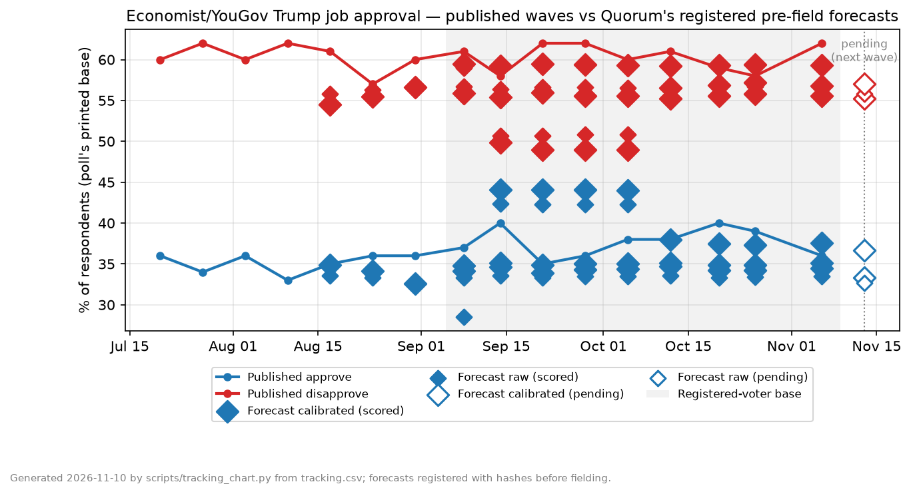

<h1 align="center">Quorum — Forward Tests</h1>

<p align="center"><b>Public, timestamped forecasts of public opinion surveys, registered before the survey is
fielded, scored against the published result, and reported whether they pass or fail.</b></p>

<p align="center">Forecasts, scores and hashes in plain files, with their git history. After a clone, anyone with
<code>git</code> and <code>shasum</code> can check a registration offline.</p>

**Here for the 2026 midterms? Start with [our projections and how to check them](MIDTERM-2026.md).** **Note:** the date in the prompt [moved our national number](capstone/date-sensitivity/README.md).

## Check a forecast yourself

Each registration is a public commit made before its poll began fielding. Compare the date of the commit that
added a registration with the poll's field dates. For example,
`git log --diff-filter=A --date=iso -- ft12/ft12-registration.md` prints commit `7e8123f` of 2026-10-28, and the
target poll fielded Nov 4–6.

`shasum -a 256 -c SHA256SUMS` compares each registered file with the hash recorded at registration. It reports 3
files as FAILED: `forward-test-1.md`, `forward-test-1b.md` and `forward-test-2.md`. We appended their verdicts to the
same files after recording the pre-field hash. The hash names the pre-field version, and
`git show cb9e3d8:forward-test-1.md | shasum -a 256` reproduces it (commit `f8d3d18` for 1-B, `0ec92c2` for 2). In
`SHA256SUMS.gs1-hh1`, `hh1/hh1-registration.md` fails for the same reason: we appended a shadow comparison on Sep 3,
and commit `4881748` holds the hashed version. The [hash convention](REGISTRATIONS.md#registration-record--frozen-artifacts)
states the rule.

## Why

Quorum is a simulated-population engine: it estimates how a population would answer a question, using an
open-weight language model conditioned on real demographic frames. The only way to know whether such a thing works
is to make it commit in advance, in public. That is what this repository is for.

One scored wave is one wave: a quarter of registered forecasts (weekly waves, a second polling house, 40+ scored
quantities) runs before any broader claim is made.

## Results



**Running tally: 84 of 96 core registered claims hit across twelve scored waves
(FT1 8/8 · FT2 8/8 · FT3 7/8 · FT4 7/8 · FT5 5/8 · FT6 7/8 · FT7 8/8 · FT8 7/8 · FT9 8/8 · FT10 5/8 · FT11 6/8 · FT12 8/8).**
Misses: the raw engine's 9-cell bar on seven waves (FT3–6, FT8, FT10 and FT11), the raw engine's topline on three
(FT5, FT10 and FT11), and the calibrated engine's topline on the two weeks approval printed 40: Sep 11–14 (calibrated
−5.4 against ±5) and Oct 19–20 (calibrated −5.8). On the approval topline over 12 waves, the calibrated engine's mean
error is 2.96, and the three simple poll rules' mean errors run from 1.75 to 2.08 ([benchmarks](BENCHMARKS.md)).

*The series so far: published waves (lines) against every registered forecast (diamonds —
filled = scored, open = wave pending; large = calibrated engine, small = raw; shaded weeks
printed on a registered-voter base, earlier weeks on adult citizens). The chart
shows the misses too: our disapprove runs visibly low (the "Not sure" over-hedge named in
the verdict). Data + sources: [`tracking.csv`](tracking.csv); one row appends per wave.*

**Per-test verdict record: [`TRACK-RECORD.md`](TRACK-RECORD.md)** — one entry per forward test, regenerated from the
register, never hand-edited. Every row for every engine and polling house is in [`SCOREBOARD.md`](SCOREBOARD.md).

## The 2026 midterm

The capstone is one registered number: the two-party House margin, **D+8.54**, registered Sep 11 with a ±3.0 bar.
We score it in December 2026, when at least 99% of the vote is counted. [`MIDTERM-2026.md`](MIDTERM-2026.md) carries
it with the seat conversion and the voter-group test, and says how to check each.

## Latest verdicts

Open: FT13, registered Nov 10 before its target poll (the next Economist/YouGov wave, expected to field
Nov 13–16), on a fresh anchor without the election sentence. Calibrated approval 33.3, raw 32.7, ygdk 36.7; the
poll rules Z1 36 and Z3 38.25 ([registration](ft13/ft13-registration.md)).

FT12 was scored against the Nov 4–6 poll, the first after the election, with its disclosures in the verdict: a sample
of 3,166, two weeks after the last poll, and a recalled House vote. Approval fell 3 points to 36, down to where the
engine sits, so every core claim hit (calibrated −1.5, raw −2.5) and the calibrated engine beat all three simple poll
rules, as it did in FT1 and FT6. The engine did not move with the poll: it rose 0.3 while the poll fell 3, so the tracking measure
failed on all four arms, and the season slope of the engine on the poll is 0.081 (1 would mean it tracks). The
arithmetic is in [`verdict-ft12-2026-11-08.md`](verdict-ft12-2026-11-08.md).

A second polling house scored for the first time on Sep 26–28: Harvard CAPS/Harris HH1 hit 5 of 8 as registered, and
its calibrated companion passed 3 of 3 ([`hh1/verdict-hh1-2026-10-01.md`](hh1/verdict-hh1-2026-10-01.md)). Its second
wave (Oct 24–26) scored HH2 7 of 10: calibrated approval +2.2 and party cuts within 7 again, with the calibrated net,
raw right track and raw ballot missing ([`hh2/verdict-hh2-2026-10-28.md`](hh2/verdict-hh2-2026-10-28.md)).

## What we found about our own engine

Our engine returns a fixed level, whatever the date. Across twelve date-only anchors from February 2017 to August 2026,
it returned 29.7% to 33.2% while real approval moved between 34% and 49%. We therefore do not forecast movement, and we
do not trust an absolute level from this engine without an external anchor. The party-structure result stands,
because it compares two engines on identical inputs; [`FINDINGS.md`](FINDINGS.md) has the full account.

## Commands

```sh
git log --diff-filter=A --date=iso -- <file>    # when a registered file entered the record
shasum -a 256 -c SHA256SUMS                     # registered files against their recorded hashes
shasum -a 256 -c SHA256SUMS.gs1-hh1             # Gallup and first Harvard CAPS/Harris registrations
shasum -a 256 -c SHA256SUMS.hh2                 # second Harvard CAPS/Harris registration
git show <commit>:<file> | shasum -a 256        # a file's hash as it stood at its registration commit
```

## What is not here

The model, adapters, and most of the harness source are not published (`hh2/code/` holds the files the HH2
registration needed); the panel microdata is not
redistributed (its licence forbids that). This repository is the *commitment record*: what
we predicted, when we predicted it, and how it scored.

## Attribution

Population frame derived from Pew Research Center's American Trends Panel, Wave 161. Source:
"Pew Research Center's American Trends Panel". Pew Research Center bears no responsibility for the analyses or
interpretations here. The opinions expressed herein, including any implications for policy, are those of the author
and not of Pew Research Center.

---

[Scoreboard](SCOREBOARD.md) · [Benchmarks](BENCHMARKS.md) · [Findings](FINDINGS.md) ·
[Registrations](REGISTRATIONS.md) · [Track record](TRACK-RECORD.md) · [Errata](ERRATA.md) ·
[Midterm 2026](MIDTERM-2026.md) · [Main test (UQ1)](uq1/README.md)
